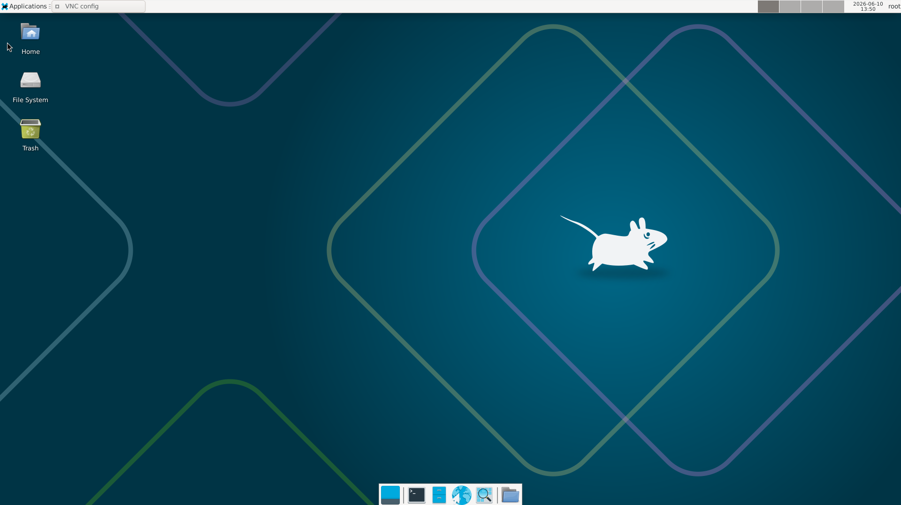
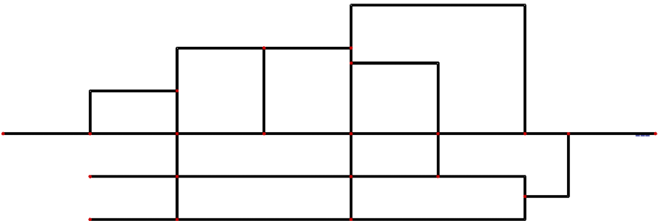
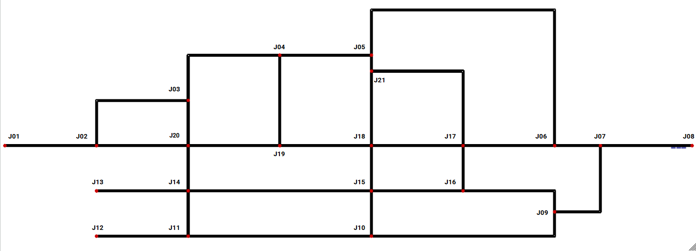
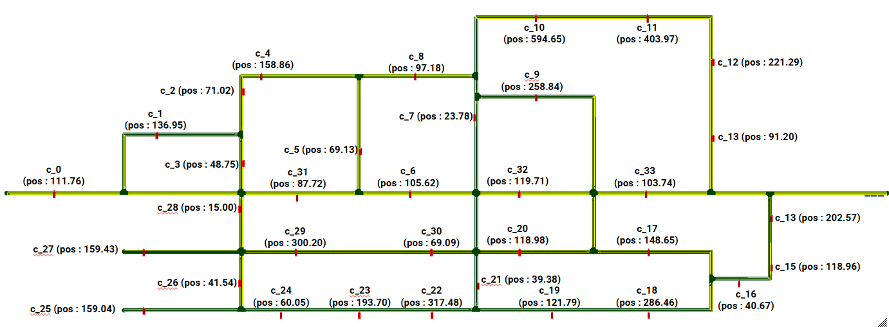
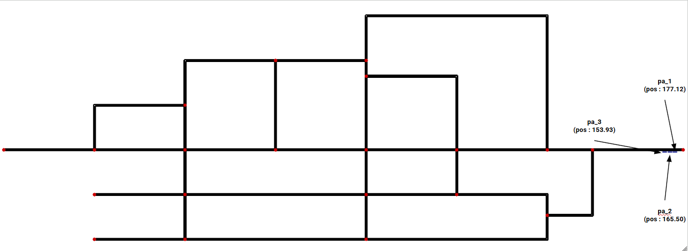

# Oasis - Wp3 - Prototype

Librairie Python interfaçable pour la simulation de mobilité urbaine via SUMO/TraCI.
 
> ⚠️ Ce projet a été développé et validé sous **linux** uniquement. Le bon fonctionnement sur d'autres certaine distributions Linux ou sur d'autre os **Windows ou macOS** n'est pas garanti
 
---
 
## Pré-requis
 
| Dépendance | Version        | Os        | Commentaires                        |
|:-----------|:--------------:|-----------|-------------------------------------|
| SUMO          | `v1_26_0+1641` | Linux     | Pas nécesaire si usage de docker    |
| Python        | `3.13.5`       | Linux     | Pas nécesaire si usage de docker    |
| Un client VNC | `N/A`          | Linux     | Si usage du container docker avec l'IHM desktop   |
| Docker        | `N/A`          | Linux     | Pas nécesaire si installation local (hors docker) |
 
---

# Architrecture du projet
## Structure des dossiers
| **Dossier** | **Rôle** | **Contenu** | **Usage principal** |
| --- | --- | --- | --- |
| **images** | Schéma de modélisation | Schémas du prototype Oasis | Référence visuelle pour conception et documentation |
| **sumo** | Modélisation SUMO | Fichiers de réseau et scénarios SUMO (xml) | Simulation du prototype dans SUMO |
| **tools** | Outils Python | Génération de container, génération procédurale de réseau SUMO | Scripts utilitaires pour automatisation |
| **lib/doc** | Documentation technique | Guides, spécifications, notes d’architecture | Lecture et maintenance technique |
| **lib/docker** | Artefacts Docker | Dockerfile et fichiers liés au container | Construction et déploiement du container projet |
| **lib/scripts** | Packaging Python | Scripts de configuration pour création du (.whl) | Packaging et distribution du module Python |
| **lib/sphinx** | Génération de documentation | Configuration Sphinx et extensions | Générer documentation HTML et PDF |
| **lib/src** | Code source | Implémentation principale du projet | Développement, tests, packaging |

## Structure des fichiers

| **Fichier** | **Emplacement** | **Rôle** | **Usage principal** |
| --- | --- | --- | --- |
| **requirements.txt** | ``requirements.txt`` | Dépendances Python | Installer les librairies nécessaires au projet |
| **docker-compose.yml** | ``docker-compose.yml`` | Orchestration Docker | Lancer l’environnement de développement ou de test |
| **pyproject.toml** | ``lib/pyproject.toml`` | Configuration du package Python | Métadonnées et configuration pour génération du ``.whl`` |
| **runBuild.sh** | ``lib/runBuild.sh`` | Script de build global | Génération de la documentation, du package Python et du container |

# Installation (si usage local hors docker)
## Simulation of Urban Mobility (SUMO) - (Linux)
- Debian 13

```bash
echo 'deb http://download.opensuse.org/repositories/science:/dlr/Debian_13/ /' \
  | sudo tee /etc/apt/sources.list.d/science:dlr.list
 
curl -fsSL https://download.opensuse.org/repositories/science:dlr/Debian_13/Release.key \
  | gpg --dearmor \
  | sudo tee /etc/apt/trusted.gpg.d/science_dlr.gpg > /dev/null
 
sudo apt update
sudo apt install sumo
```

- xUbuntu 26.04

```bash
echo 'deb http://download.opensuse.org/repositories/science:/dlr/xUbuntu_26.04/ /' | sudo tee /etc/apt/sources.list.d/science:dlr.list

curl -fsSL https://download.opensuse.org/repositories/science:dlr/xUbuntu_26.04/Release.key | gpg --dearmor | sudo tee /etc/apt/trusted.gpg.d/science_dlr.gpg > /dev/null

sudo apt update
sudo apt install sumo
```

- Fedora 44

```bash
dnf config-manager addrepo --from-repofile=https://download.opensuse.org/repositories/science:dlr/Fedora_44/science:dlr.repo
dnf install sumo
```

- CentOS 8

```bash
cd /etc/yum.repos.d/
wget https://download.opensuse.org/repositories/science:dlr/CentOS_8/science:dlr.repo
yum install sumo
```

> Pour l'installation de sumo sur d'autre distribution ou version https://software.opensuse.org//download.html?project=science%3Adlr&package=sumo

## Environnement de développement

**1. Installation des outils pour la documentation**
 
```bash
apt-get install texlive-latex-base texlive-latex-extra \
        texlive-fonts-recommended texlive-xetex \
        latexmk fonts-freefont-ttf xindy -y
 
wget https://dl.google.com/linux/direct/google-chrome-stable_current_amd64.deb
apt-get install ./google-chrome-stable_current_amd64.deb
```
 
**2. Environnement virtuel Python**
 
```bash
apt-get install python3-venv # si non présent
python3 -m venv <nom_du_venv>
source ./<nom_du_venv>/bin/activate
pip install -r <fichier_requirements.txt>
```

---

## Docker
**1. usage de docker compose**

```bash
# depuis la racine du projet
docker compose --profile oasis up -d # build et run du container docker
```


## Mise en production
**1. Build de la librairie python**

```bash
# Depuis la racine du dossier lib :
bash ./runBuild.sh 
```
> La phase de build du projet Python (package .whl) se compose de trois étapes :
- Génération du package Python au format .whl dans le dossier ./lib/dist
- Génération de la documentation au format PDF dans le dossier ./lib/doc
- Construction d'une image Docker complète pour le projet (développement / test / production) dans le dossier ./lib/dist

> À la fin du cycle, vous devriez trouver dans le dossier ./lib/dist les éléments suivants :
- oasisprototype-1.0.0-py3-none-any.whl (le format lib du projet)
- oasiswp3_1_0_0.tar (le container docker)

**2. Déployement du container**

```bash 
# Si container déja présent
docker stop <nom du container> # si en cours de fonctionnement
docker rm <nom du container>
docker rmi <nom du container:version>
docker run --name oasis -d -p 5901:5901 <le nom du container>
```

```bash 
docker load -i <le container au format .tar>
docker run --name oasis -d -p 5901:5901 <le nom du container>
```

**3. Connection via un client VNC**
```bash
127.0.0.1:5901 ou localhost:5901
password : oasiswp3
```



## Installation en local (hors docker)
**1. Création d'un environnement virtuel python**
```bash
apt-get install python3-venv # si non présent
python3 -m venv <nom_du_venv>
source ./<nom_du_venv>/bin/activate
 
pip install <fichier.whl>
 
# Pour remplacer une version existante
pip install --force-reinstall <fichier.whl>
```
 
---

## Modélisation du réseau 'prototype' sous SUMO
 
Le réseau est composé de **21 jonctions** et de **2 edges** entre chaque jonction. Il suit une convention de nommage stricte.
 
| Élément | Convention | Exemple |
|:--------|:----------:|--------:|
| Jonction | `J(identifiant)` | `J07` |
| Edge (route) | `E(src)to(dst)` | `E21to18` |
| Container | `c_(identifiant)` | `c_01` |
| Parking (dépôt) | `pa_(identifiant)` | `pa_01` |
 
Les containers représentent les points de collecte et disposent d'une position en mètres depuis le point zéro de l'edge de départ. Les parkings simulent le dépôt en fin de cycle.

### Figure 1 — Modélisation du réseau via NETEDIT
 


---

### Figure 2 — ID de chaque junction
 


---
 
### Figure 3 — ID de chaque edge
 


---
 
### Figure 4 — ID et position de chaque container
 


---
 
### Figure 5 — ID et position de chaque parking
 
